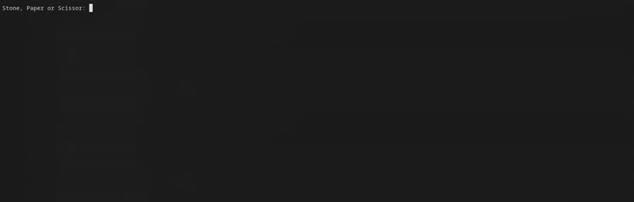
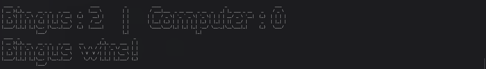

### Hi, I'm Rithwik 👋

I'm a big transformers fan 🤖

### Here are some things I've worked on...

* ⚡ **[Cross-Platform OS Power & Telemetry Suite](https://github.com/Rithwik-7274/Automation-Scripts)** — 1Hz hardware power-gating (`turbostat`, `AMDuProfCLI`, `nvidia-smi`, `tinytuya`) across Linux & Windows 11.
* 📟 **[U8g2 Hardware-in-the-Loop (HIL) Canvas](https://github.com/Rithwik-7274/U8g2-HIL-Canvas)** — 64-byte binary UART/DMA protocol & C firmware parser for real-time MCU display prototyping.
* 🪖 **[Culturally-Adaptive Traffic Helmet Detection](https://github.com/Rithwik-7274/CADSIT)** — Grounding DINO + LLaVA automated curation pipeline with YOLOv11 & RT-DETR.
* 🧬 **[Adam-E Optimizer](https://github.com/Rithwik-7274/Adam-E)** — Hybrid evolutionary-gradient optimizer escaping rugged local minima on 12-bit Parity, Starved Spirals & 40% Corrupted MNIST.
* 🎲 **[MCMC Samplers & Stochastic Optimization](https://github.com/Rithwik-7274/MCMC-Optimisation-Benchmarks)** — From-scratch RWMH & Gilks' ARMS samplers with Simulated Annealing and FFT Effective Sample Size benchmarking.

#### 🪨📜✂️

  
  

**[Stone Paper Scissors game](https://github.com/Rithwik-7274/Stone-Paper-Scissors-Game)**

Built from scratch in **C** with state-based logic, strict input validation, and custom terminal ASCII art rendering—packaged and maintained on the **Arch User Repository (AUR)** and **Homebrew** for Linux & macOS.
